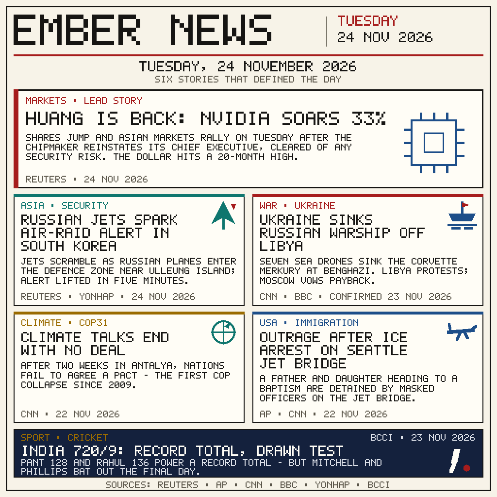

# Ember News 24 November

[](https://make.fun/c/news-image-20261124)
[](https://make.fun/c/news-image-20261124)
[](https://make.fun/c/news-image-20261124)

A one-page front page summing up Tuesday 24 November 2026 world news,
drawn entirely in code for the make.fun
[news-image-20261124](https://make.fun/c/news-image-20261124) bounty.



## The day in the image

- **Lead — Huang is back, Nvidia soars 33%:** shares jump and Asian
  markets rally on Tuesday after the chipmaker reinstates its chief
  executive, cleared of any security risk. The dollar hits a 20-month
  high. (Reuters, 24 Nov 2026)
- **Asia — Russian jets spark air-raid alert in South Korea:** fighter
  jets scramble as Russian planes enter the defence zone near Ulleung
  Island; the warning is lifted after five minutes, with no airspace
  breach. (Reuters / Yonhap, 24 Nov 2026)
- **War — Ukraine sinks a Russian warship off Libya:** seven sea drones
  sink the corvette Merkury at Benghazi. Libya protests; Moscow vows
  payback. (CNN / BBC, confirmed 23 Nov 2026)
- **Climate — COP31 ends with no deal:** after two weeks in Antalya,
  nations fail to agree a pact, the first COP collapse since 2009.
  Fossil fuels were the fault line. (CNN, 22 Nov 2026)
- **USA — Outrage after ICE arrest on a Seattle jet bridge:** a father
  and daughter heading to a baptism are detained by masked officers.
  (AP / CNN, 22 Nov 2026)
- **Sport — India 720/9, a record total, but the Test is drawn:** Pant
  128 and Rahul 136 power India's highest Test total in New Zealand;
  Mitchell and Phillips bat out the final day at Wellington.
  (BCCI, 23 Nov 2026)

## How it is made

`main.ts` (Node 22, standard library only) plots every pixel itself into a
1024x1024 PNG: a hand-built 5x7 bitmap font, small vector-style icons for
each story (chip, jet, ship, globe, plane, cricket bat), and a deterministic
PNG encoder with its own fixed-Huffman DEFLATE compressor. No network, no
external images. Run it with:

```sh
mkdir -p out && MAKEFUN_OUTPUT_DIR=out node main.ts
```

It writes `out/entry.png` (1024x1024, ~190 KB), byte-identical on every run.

## License

MIT — see [LICENSE](LICENSE).
